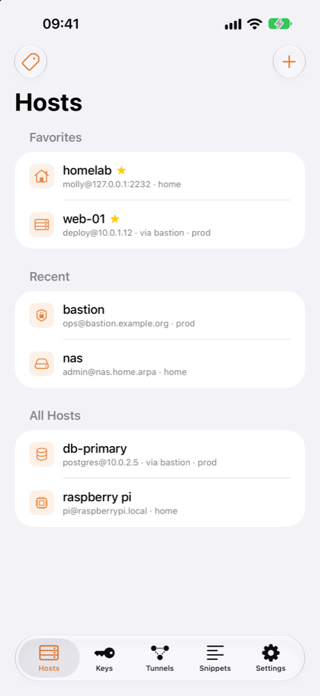
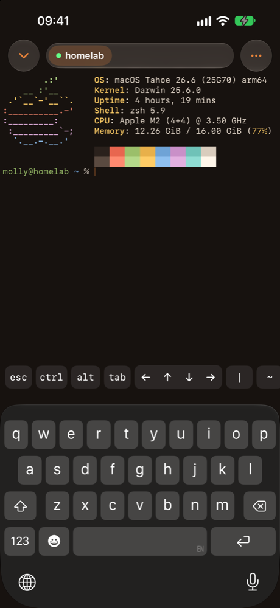
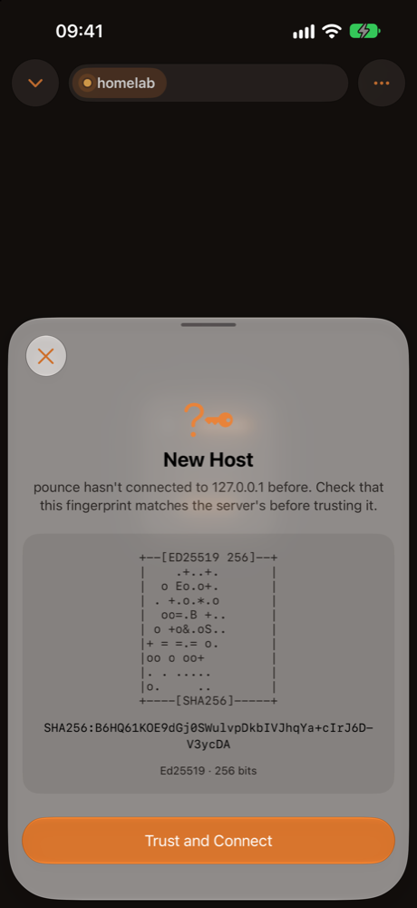
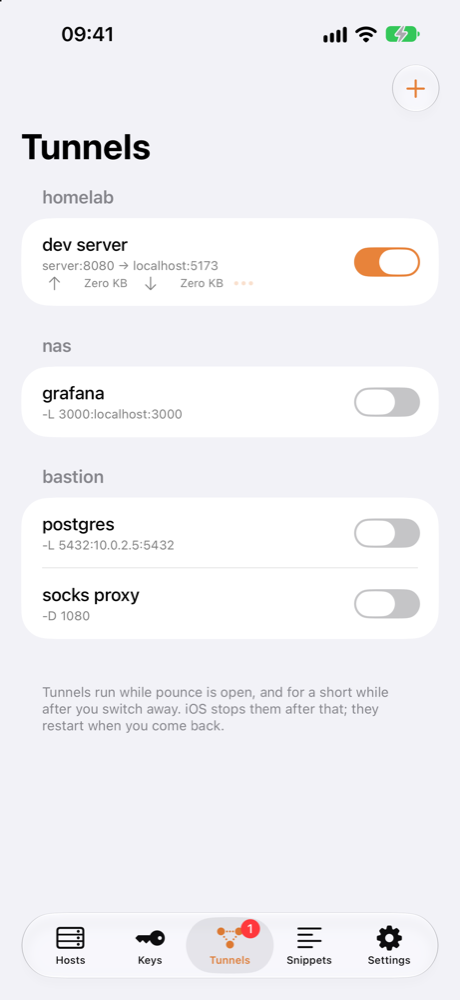

# pounce

a small native ssh client for ios that keeps your keys on the device.

  
  
  
  

jump hosts, `-L` / `-R` / `-D` tunnels, ed25519 / ecdsa / rsa keys and secure enclave, face id lock.

open `pounce.xcodeproj` in xcode, ios 26.1+.
